# International Cambridge School Kishtwar ERP — Enterprise Management Platform

[](https://nodejs.org/)
[](https://reactjs.org/)
[](https://tailwindcss.com/)
[](https://sequelize.org/)
[](#-institution-branding--color-theme)
[](#-cybersecurity-hardening--active-waf)
[](#-automated-testing-suites)
[](LICENSE)

A modern, production-ready, full-stack **Enterprise Resource Planning (ERP)** platform tailored for **International Cambridge School Kishtwar**, academies, and multi-branch educational networks.

Features role-scoped academic portals, automated CBSE/State-style **Marksheet Cum Certificate** PDF generators, an authoritative **Central Platform Connector** with real-time operational sync via School ID, a dedicated **Business Subscription & Monthly Billing Engine**, and enterprise-grade **Cybersecurity & Web Application Firewall (WAF)** defenses.

---

## 📑 Table of Contents

- [Institution Branding & Color Theme](#-institution-branding--color-theme)
- [Architectural Overview](#-architectural-overview)
- [Core Functional Modules](#-core-functional-modules)
  - [1. Multi-Role Educational Portals](#1-multi-role-educational-portals)
  - [2. Student Performance & Marksheet Cum Certificate Generation](#2-student-performance--marksheet-cum-certificate-generation)
  - [3. Central Management Platform Integration & School ID](#3-central-management-platform-integration--school-id)
  - [4. Business Subscription & Billing Module](#4-business-subscription--billing-module)
  - [5. Strict Non-Financial Data Isolation](#5-strict-non-financial-data-isolation)
- [Cybersecurity Hardening & Active WAF](#-cybersecurity-hardening--active-waf)
- [Project Directory Structure](#-project-directory-structure)
- [Installation & Quick Start](#-installation--quick-start)
- [cPanel & VPS Cron Configuration](#-cpanel--vps-cron-configuration)
- [Automated Testing Suites](#-automated-testing-suites)
- [API Reference Summary](#-api-reference-summary)
- [Git Repository & Author](#-git-repository--author)

---

## 🎨 Institution Branding & Color Theme

- **Official Name**: `International Cambridge School Kishtwar`
- **Color Identity**: **Royal Blue** (`#1E3A8A`, `#2563EB`) paired with **Golden Yellow** (`#FACC15`, `#EAB308`).
- **Applied Everywhere**: Top navigation bars, sidebars, active badges, status indicators, buttons, data tables, and high-resolution PDF certificate outputs adhere strictly to this high-contrast educational color scheme.

---

## 🏛️ Architectural Overview

```mermaid
flowchart TD
    subgraph ClientLayer["Frontend Application (React 18 + Tailwind CSS)"]
        UI_ADMIN["Admin & Admin2 Portals"]
        UI_TEACHER["Teacher Portal (Class-Scoped)"]
        UI_STUDENT["Student & Parent Portals"]
        UI_FC["Fee Collector Portal"]
        UI_SETTINGS["School Settings & Central School ID (Send Real Data)"]
        UI_CENTRAL["Central School ID Page (Clean ID Display Only)"]
        UI_SUSPEND["Red-Themed Service Suspension Screen"]
    end

    subgraph SecurityLayer["Security & Gateway Perimeter"]
        WAF["Enterprise WAF (securityLogger.js)"]
        HELMET["Hardened HTTP Headers (CSP, HSTS, Clickjacking Guard)"]
        RATE_LIMIT["Tiered Rate Limiters (Auth, Password, Admin, Fees)"]
        CSRF_GUARD["Double-Submit CSRF Protection"]
        ENTITLEMENT["Entitlement Check (Non-Destructive HTTP 423 Suspension)"]
    end

    subgraph ServiceLayer["Backend Engine (Node.js + Express + Sequelize)"]
        AUTH_SVC["Auth Service (Timing-Safe Login, Bcrypt Cost 12)"]
        ACADEMIC_SVC["Academic Engine (Marks, Attendance, Timetable, PDF Reports)"]
        FEE_SVC["School Fee Ledger (Strictly Air-Gapped)"]
        CENTRAL_SVC["Central Integration Connector (HMAC-SHA256, Replay Defense)"]
        BILLING_SVC["Business Subscription & Monthly Payment Register"]
        SETTINGS_SVC["Settings & School ID Dual-Persistence Engine"]
    end

    subgraph DatabaseLayer["Persistence Layer (Sequelize ORM - MySQL / SQLite)"]
        DB_ACADEMICS[("Academic, Student & Teacher Tables")]
        DB_FEES[("Internal School Fee & Structure Tables")]
        DB_CENTRAL[("CentralConfig, SyncLogs, CommandLogs")]
        DB_BILLING[("CentralSubscriptions, BillingInvoices, PaymentRegister")]
        DB_SETTINGS[("Setting (Key-Value Store, Logo Base64, School ID)")]
    end

    ClientLayer --> SecurityLayer
    SecurityLayer --> ServiceLayer
    ServiceLayer --> DatabaseLayer
```



---

## 🚀 Core Functional Modules

### 1. Multi-Role Educational Portals

| Role | Access Level & Key Capabilities |
| :--- | :--- |
| **Super Admin (`admin`)** | Full system control: academic sessions, timetable generator, staff credentials, fees, logs, school settings, and centralized School ID management. |
| **Admin 2 (`admin2`)** | Secondary administration: result approvals, student admissions, class incharge assignments, datesheets, and staff attendance. |
| **Teacher (`teacher`)** | **Strictly scoped to assigned classes**: attendance marking, marks entry, subject analytics, leave applications, and student performance tracking. Teachers can only see students under their care. |
| **Student / Parent (`student`, `parent`)** | View personal academic marks, attendance %, exam timetables, download marksheet cum certificates, and check fee status (protected against IDOR). |
| **Fee Collector (`fee_collector`)** | Student fee collection, receipt generation, category management, admissions, and fee structure queries. |

---

### 2. Student Performance & Marksheet Cum Certificate Generation

- **Role-Scoped Performance Analytics**: Administrators and Teachers can view detailed academic performance. Teachers are cryptographically and query-scoped to see **only students belonging to classes assigned to them**.
- **CBSE/State-Style "Marksheet Cum Certificate" Layout**:
  - **Decorative Outer Borders**: Rich Royal Blue with Golden Yellow internal borders and a top 16-color pencil header.
  - **School Header & Dynamic Logo**: Automatically embeds the administrator-uploaded school logo from settings, school title, subtitle, DICE number, and session.
  - **Student Bio Details**: Class, Roll No, Admission/Scholar No, Caste, Aadhar No, Family ID, and SSSMID.
  - **DOB Conversion**: Formats Date of Birth in standard format as well as formal words (e.g., `15-08-2010` &rarr; `Fifteenth August Two Thousand Ten`).
  - **Dual Assessment Tables**:
    - **Main Academic Subjects**: Detail subjects, maximum marks (theory + internal), minimum passing marks, marks obtained, and grade.
    - **Personal & Social Qualities (Co-Scholastic)**: Computer & G.K., Regularity, Yoga Activities, Behaviour & Compassion, Respectful & Courteous, Discipline, and Arts & Craft with grades ($A, B, C$).
  - **Summary & Signatures**: Result status (Passed/Promoted), Percentage, Division, Class Rank, Promoted Class, School Reopen date, Class Teacher signature space, and Principal signature space.

---

### 3. Central Management Platform Integration & School ID

Connects this ERP installation to our centralized multi-school management platform:

- **Configure School ID in ERP Settings (`/admin/settings`)**:
  - The ERP asks for the **School ID** to connect and send real operational data to our centralized management platform.
  - Displays live connection status badge: `● Connected & Syncing Real Data`.
  - Provides a **Copy School ID** button and a **Sync Real Data Now** button.
  - When saving settings, the School ID is dual-persisted to both `Setting` and `CentralConfig`, immediately triggering background telemetry synchronization.
- **Clean School Identifier Page (`/admin/central-integration`)**:
  - As requested, all clutter (manual pairing tokens, verification forms, approval request popups, audit tables) has been removed from the School ERP view.
  - **Shows School ID Only**: Displays the permanent School ID (e.g. `SCH-2026-01001`), connection status badge, inline edit/update tool, live sync button, and basic school info.
- **Permanent School ID Preservation on Approval**:
  - When an administrator inputs the School ID into the Central Management Web Platform and approves the connection, the ERP automatically processes the approval challenge in the background.
  - **The School ID is NEVER removed, reset, or deleted from the ERP**.
  - No approval request popups or challenge tokens interrupt the school staff in the ERP.
- **Live Operational Data Synchronization**:
  - Transmits real operational statistics (active students, teacher headcount, attendance rates, academic classes, class distributions) securely to the central platform.
  - Background synchronization via cron (`node server/scripts/cronSync.js`) with built-in concurrency lock-file protection.

---

### 4. Business Subscription & Billing Module

Manages **our commercial ERP service revenue** (software subscriptions schools pay to us for using the ERP platform):

- **School Subscription Profiles**: Configures plans (`Standard`, `Professional`, `Enterprise`, `Custom`), standard monthly charges, custom rates, validity dates, and grace periods.
- **Monthly Billing Register**: Generates monthly invoices for each school. Supports **full payments**, **partial payments**, **unpaid accounts**, and **overpayments** (advance credit).
- **Historical Charge Preservation**: Modifying future subscription charges preserves historical invoices and billing records without altering past accounting.
- **Audited Payment Corrections**: Correcting payment records requires a mandatory reason and logs before/after values to `CentralBillingAuditLog`.
- **Centralized Suspension / Reactivation Workflow**: Central administrators can remotely pause or restore school access with confirmation dialogs, outstanding balance displays, and command acknowledgements.
- **Red-Themed Suspension Page (`/suspended`)**: Displays a mobile-responsive screen informing users of the temporary pause, providing billing support contacts, and guaranteeing that all school records are safe.
- **Separation of Concerns**: Central billing controls are reserved for the central management platform operators; the school ERP admin navigation remains clean and focused solely on school academic tasks.

---

### 5. Strict Non-Financial Data Isolation

> [!IMPORTANT]
> **STRICT ARCHITECTURAL AIR-GAP**:
> - The central connector and operational telemetry engines **NEVER** collect, read, store, or transmit internal school finances (student fees, fee balances, fee structures, receipts, school bank accounts, expenses, or staff payroll).
> - Multi-layer enforcement:
>   1. **Model Layer**: `Fee` and `ClassFeeStructure` models are never imported into central sync routines.
>   2. **Runtime Scanner**: `securityService.assertNoFinancialData()` deeply inspects payloads prior to transmission and throws fatal exceptions if any financial keyword is detected.
>   3. **Automated Verification**: Negative automated tests verify that injecting fee data triggers instant security rejections.

---

## 🔒 Cybersecurity Hardening & Active WAF

The platform is fortified against the OWASP Top 10 vulnerabilities:

```
+---------------------------------------------------------------------------------------------------+
| THREAT VECTOR                 | DEFENSIVE IMPLEMENTATION IN CAMBRIDGE ERP                         |
+---------------------------------------------------------------------------------------------------+
| SQL Injection (SQLi)          | Parameterized Sequelize queries + Active WAF regex inspection     |
| Cross-Site Scripting (XSS)    | React auto-escaping + WAF script filter + Strict CSP headers       |
| Remote Command Injection      | Strict command whitelist; arbitrary shell execution blocked       |
| Prototype Pollution           | Deep object inspection blocking '__proto__' and 'constructor'     |
| Directory Traversal / LFI     | Path basename normalization + strict upload boundary validation   |
| Authentication Timing Attacks | Normalized dummy bcrypt compare on non-existent account lookups   |
| MIME-Type Spoofing / Polyglot | Binary magic-byte header validation (JPEG, PNG, WebP, GIF)        |
| Insecure Direct Object (IDOR) | Strict role guard: teachers denied access to student fee ledgers  |
| Brute Force / DDoS            | Tiered rate limiters (Auth, Password Change, Credentials, Fees)   |
| Clickjacking & Sniffing       | 'X-Frame-Options: DENY', 'X-Content-Type-Options: nosniff'        |
| Token Forgery                 | Strict JWT secret entropy check; fails safe in production         |
| Information Disclosure        | Production error handler sanitizes messages; stack traces hidden  |
+---------------------------------------------------------------------------------------------------+
```

---

## 📁 Project Directory Structure

```text
Cambridge-ERP/
├── package.json                   # Root workspace orchestrator & test runner
├── README.md                      # Comprehensive system documentation
├── client/                        # React frontend SPA
│   ├── public/                    # Static assets & HTML template
│   ├── src/
│   │   ├── components/            # Reusable UI (Sidebar, Navbar, Modals)
│   │   ├── context/               # AuthContext & SettingsContext
│   │   ├── pages/
│   │   │   ├── admin/             # Admin dashboard, settings, logs
│   │   │   │   ├── Settings.jsx                 # School profile & Central School ID config
│   │   │   │   ├── CentralIntegration.jsx       # Simplified Central School ID display UI
│   │   │   │   └── CentralBillingDashboard.jsx  # Central platform revenue & billing UI
│   │   │   ├── common/
│   │   │   │   ├── StudentPerformance.jsx       # Student analytics & marksheet PDF
│   │   │   │   └── SuspensionPage.jsx           # Red-themed service suspension page
│   │   │   ├── teacher/           # Teacher attendance & grading (class-scoped)
│   │   │   └── parent/            # Student & parent portal screens
│   │   └── utils/api.js           # Axios interceptors (CSRF, 401, 423 redirect)
│   └── package.json
└── server/                        # Node.js Express backend API
    ├── server.js                  # App bootstrap, security headers, route mounting
    ├── config/                    # Database (MySQL/SQLite) and RBAC definitions
    ├── middleware/                # Security middleware stack
    │   ├── auth.js                # JWT verification, RBAC helpers
    │   ├── csrf.js                # Double-submit cookie CSRF guard
    │   ├── entitlementCheck.js    # Application-level suspension middleware (HTTP 423)
    │   ├── errorHandler.js        # Production error sanitizer
    │   ├── rateLimiters.js        # Multi-tier endpoint rate limiters
    │   ├── securityLogger.js      # Enterprise inline WAF threat scanner
    │   └── upload.js              # Multer + binary magic-byte validator
    ├── models/                    # Sequelize database models
    │   ├── Setting.js             # School name, address, logo, and School ID
    │   ├── CentralConfig.js       # School ID, connector secrets & status
    │   ├── CentralSyncLog.js      # Audit log for non-financial telemetry sync
    │   ├── CentralCommandLog.js   # Audit log for remote management commands
    │   ├── CentralSubscription.js # School subscription plans & custom charges
    │   ├── CentralBillingInvoice.js # Historical monthly billing invoices
    │   ├── CentralBillingPayment.js # Payment register with correction tracking
    │   └── CentralBillingAuditLog.js # Forensic audit trail for revenue changes
    ├── routes/                    # API endpoints
    │   ├── settings.js            # Settings & Central School ID configuration
    │   ├── central.js             # School ID endpoints, approve, diagnostics, webhooks
    │   ├── centralBilling.js      # Revenue dashboard, subscriptions, payment register
    │   ├── students.js            # Student records & consolidated PDF generator
    │   ├── fees.js                # School internal fee ledger (RBAC hardened)
    │   └── auth.js                # Authentication, lockout, and password management
    ├── scripts/
    │   └── cronSync.js            # Standalone cPanel / VPS CLI cron sync runner
    ├── services/central/          # Core connector & billing engines
    │   ├── billingService.js      # Subscription & payment ledger management
    │   ├── commandProcessor.js    # Predefined remote command whitelist dispatcher
    │   ├── configService.js       # Permanent School ID and credential rotation
    │   ├── dataExtractor.js       # Non-financial operational data aggregator
    │   ├── httpClient.js          # Lightweight native fetch client
    │   ├── mockCentralPlatform.js # Built-in sandbox & fallback provider
    │   ├── pairingService.js      # Challenge-response pairing verification
    │   ├── registrationService.js # Authoritative registration handler
    │   ├── securityService.js     # HMAC-SHA256, timing-safe checks, assertNoFinancialData
    │   └── syncEngine.js          # Heartbeat telemetry and operational sync
    ├── tests/                     # Automated test suites
    │   ├── centralIntegration.test.js # 12-point connector verification suite
    │   ├── centralBilling.test.js     # 10-point revenue & billing verification suite
    │   └── securityHardening.test.js  # 10-point active WAF & attack verification suite
    └── package.json
```

---

## ⚙️ Installation & Quick Start

### Prerequisites
- **Node.js**: v18.0.0 or higher
- **npm**: v9.0.0 or higher
- **Database**: MySQL (Production) or SQLite3 (Development / Staging)

### Step-by-Step Setup

```bash
# 1. Clone the repository
git clone https://github.com/httpsghsthakur/Cambridge-ERP.git
cd Cambridge-ERP

# 2. Install dependencies for root, server, and client
npm run install:all

# 3. Configure backend environment
cp server/.env.example server/.env
# Edit server/.env with your JWT_SECRET, PORT, and database credentials

# 4. Seed the database with initial sessions and admin user
npm run seed

# 5. Start the production server (serves both API and React frontend)
npm start
```

### Development Mode (Concurrent Terminals)

```bash
# Terminal 1: Backend API with Nodemon auto-reload
npm run dev:server

# Terminal 2: React Development Server
npm run dev:client
```

---

## ⏱️ cPanel & VPS Cron Configuration

For production environments on cPanel, shared Linux hosting, or VPS deployments, scheduled non-financial operational synchronization can be configured via cron:

```bash
# Example cPanel Cron Job (runs every hour):
/usr/local/bin/node /home/username/public_html/server/scripts/cronSync.js >> /home/username/cron_sync.log 2>&1
```

- **Concurrency Lock**: Employs a file-based lock (`.cron_sync.lock`) with a 15-minute timeout to prevent overlapping executions.
- **Graceful Error Handling**: Automatically logs telemetry status, releases locks upon completion, and terminates with standard exit codes.

---

## 🧪 Automated Testing Suites

The platform includes **32 automated tests** across 3 test suites verifying integration, revenue management, and security defenses:

```bash
# Run all 3 test suites from root
npm test

# Or run directly inside server directory
npm test --prefix server
```

### Test Suite Summary

1. **Central Platform Integration (`centralIntegration.test.js`)**: 12 Tests
   - Permanent School ID assignment & duplicate protection
   - Challenge-response pairing & automatic permission provisioning
   - Aggregated operational telemetry extraction (zero PII)
   - Strict financial data exclusion assertion (`assertNoFinancialData`)
   - Predefined command whitelist & rejection of arbitrary SQL/shell code
   - HMAC-SHA256 signature verification & timestamp replay protection
   - Application-level suspension and instant reactivation
2. **Business Subscription & Billing (`centralBilling.test.js`)**: 10 Tests
   - Custom pricing, plans, and historical rate preservation
   - Full, partial, and overpayments in monthly payment register
   - Payment corrections with mandatory audit trail
   - Dashboard revenue metrics and balance calculations
   - Remote suspension with mandatory reasoning & data preservation proof
   - Remote reactivation and access restoration
   - Total financial air-gap from school internal fee tables
3. **Security Hardening & WAF (`securityHardening.test.js`)**: 10 Tests
   - Emergency route `/api/fix-db` locked behind SuperAdmin
   - Active WAF blocks SQL Injection, XSS, and Prototype Pollution
   - Active WAF blocks Path Traversal and Remote Command Injection
   - Automated penetration testing bot fingerprinting (`sqlmap`, `nikto`)
   - Binary magic-byte image validation rejecting spoofed files
   - Teacher role denied access to student fee ledgers (IDOR defense)
   - Error handler suppresses stack traces in production

---

## 📡 API Reference Summary

### Authentication & Core Endpoints
- `POST /api/auth/login` — Timing-attack protected login (sets `httpOnly` JWT cookie).
- `POST /api/auth/logout` — Secure cookie invalidation.
- `GET /api/auth/me` — Fetches authenticated user profile and permissions.
- `PUT /api/auth/change-password` — Rate-limited password updates.

### Settings & School ID Endpoints (`server/routes/settings.js`)
- `GET /api/settings` — Returns school details, address, logo, and active School ID.
- `PUT /api/settings` — Updates school profile and configures School ID with instant live operational sync.
- `POST /api/settings/upload-logo` — Uploads and stores base64-encoded institutional logo.

### Central Platform Connector Endpoints (`server/routes/central.js`)
- `GET /api/central/status` — Connector state, permanent School ID, and sync status.
- `POST /api/central/set-school-id` — Updates/configures School ID and immediately transmits real operational data.
- `POST /api/central/approve` — Remote approval endpoint from Central Platform (retains School ID permanently).
- `POST /api/central/sync` — Manually triggers non-financial operational data sync.
- `POST /api/central/heartbeat` — Sends technical telemetry and retrieves pending commands.
- `GET /api/central/diagnostics` — Runs comprehensive connector integrity checks.
- `GET /api/central/suspension-info` — Public status check for the suspension screen.
- `POST /api/central/webhook` — HMAC-SHA256 authenticated inbound management webhook.

### Business Billing & Subscription Endpoints (`server/routes/centralBilling.js`)
- `GET /api/central-billing/dashboard` — Revenue analytics, charges, and 6-month trends.
- `GET /api/central-billing/subscriptions` — List school subscriptions and balances.
- `PUT /api/central-billing/subscriptions/:school_id/charges` — Update subscription pricing.
- `POST /api/central-billing/subscriptions/:school_id/generate-invoice` — Generate monthly invoice.
- `POST /api/central-billing/payments` — Record payment in monthly register.
- `PUT /api/central-billing/payments/:payment_id` — Correct payment with mandatory audit reason.
- `POST /api/central-billing/subscriptions/:school_id/suspend` — Issue remote suspension command.
- `POST /api/central-billing/subscriptions/:school_id/reactivate` — Issue remote reactivation command.
- `GET /api/central-billing/audit-logs` — Complete billing and command audit history.

### Academic & Student Records Endpoints
- `GET /api/students` — Filtered student records (role-scoped for teachers).
- `GET /api/students/:id/consolidated-marksheet` — Generates CBSE-style Marksheet Cum Certificate PDF.
- `GET /api/students/:id/performance-report` — Generates comprehensive performance report PDF.
- `GET /api/fees/student/:studentId` — Student fee ledger (restricted to admin, fee collector, and student).

---

## 👤 Git Repository & Author

- **GitHub Repository**: [`https://github.com/httpsghsthakur/Cambridge-ERP.git`](https://github.com/httpsghsthakur/Cambridge-ERP.git)
- **Author Identity**: `httpsghsthakur <gt64384@gmail.com>`
- **Active Branch**: `main`
- **License**: ISC
